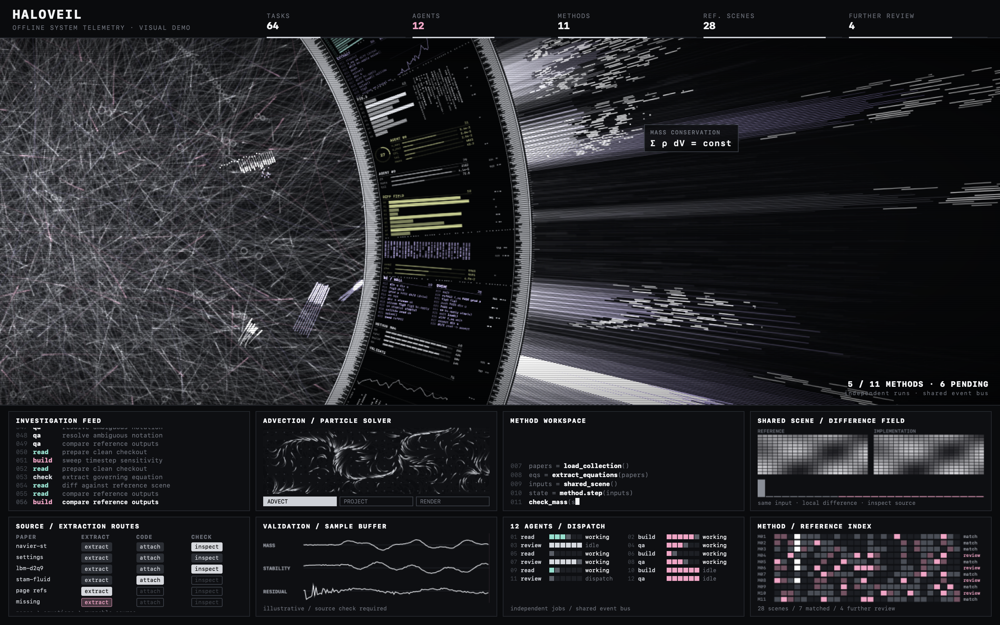

# HaloVeil · 光幕

[English](README.md) · [简体中文](README.zh-CN.md) · [English / 中文](README.bilingual.md)

A silent, offline macOS screen saver: a rotating data ring, woven light field, and animated telemetry panels.

一款无声、离线运行的 macOS 屏保：旋转数据环、交织光场与动态遥测面板。

**Modified from / 基于 [HALOFLUX by Ryder191 (RYDER CODE / Ms MAIKEBAIs CAT)](https://github.com/Ryder191/haloflux) 修改。Noncommercial use only / 仅限非商业用途。** The original visualization and visual design belong to the upstream author. 原可视化及视觉设计属于原作者，HaloVeil 是独立的 macOS 适配项目。



## Download & install / 下载与安装

1. **[Download HaloVeil 1.0.0 / 下载安装包](downloads/HaloVeil-1.0.0.zip?raw=true)** and unzip it. / 解压安装包，找到 `HaloVeil.saver`。
2. Double-click **`HaloVeil.saver`**, then choose **Install for this user**. / 双击 `.saver`，选择 **「仅为此用户安装」**。
3. Open **System Settings → Screen Saver → Other → HaloVeil**. / 打开 **「系统设置 → 屏幕保护程序 → 其他 / Other → HaloVeil」** 切换。
4. On versions with grouped settings: **System Settings → Wallpaper → Screen Saver → Custom → Other → HaloVeil**. / 如果该版本将选项放在墙纸设置中，使用 **「系统设置 → 墙纸 → 屏幕保护程序 → 自定 / Custom → 其他 / Other → HaloVeil」**。
5. Start it with **Preview** or a Hot Corner; move the pointer or press a key to exit. / 点击 **「预览 / Preview」** 或使用触发角启动，移动鼠标或按键退出。

**Installation alone may not switch the active saver. Select HaloVeil under Other after installing. / 安装文件不一定会自动切换屏保，安装后请务必在「其他 / Other」中选中 HaloVeil。** Reopen System Settings if it has not appeared. / 暂时看不到时，退出并重开系统设置。

[English install guide](docs/INSTALL.md) · [中文安装说明](docs/INSTALL.zh-CN.md) · [SHA-256](downloads/SHA256SUMS)

## Features & limits / 功能与边界

| English | 中文 |
| --- | --- |
| Native ScreenSaverView + WKWebView, bundled offline resources | 原生屏保宿主，随包提供网页资源，离线运行 |
| Silent; no Wallpaper Engine or audio files | 无声，无需 Wallpaper Engine，不含音频文件 |
| Prepare resources first, then fade in | 先预热资源，再淡入动画 |
| 60 FPS target; one active renderer per display | 目标 60 帧；每个屏幕一个活动实例 |
| Apple Silicon + Intel universal build | Apple Silicon 与 Intel 通用构建 |
| Simulated telemetry, not live AI-agent integration | 遥测数据为视觉演示，尚未接入真实 AI agent |
| A screen saver, not a replacement for wallpaper or password entry | 属于屏保，不替换壁纸、密码输入或开机解锁界面 |

The build targets macOS 12+ and the adaptation was tested on macOS Sonoma 14.4.1. Downloaded binaries are ad-hoc signed, not Apple-notarized. Startup includes a short dark preparation interval (about one second on the tested Mac) and a 0.18-second fade. Frame rate depends on system load.

编译目标为 macOS 12 及以上，适配版已在 macOS Sonoma 14.4.1 测试。安装包采用本地签名，未经 Apple 公证。启动先有短暂深色准备画面，在测试机器上约 1 秒，随后约 0.18 秒淡入；实际帧率受系统负载影响。

## Build & test / 构建与测试

With Apple Command Line Tools and Python 3 installed / 安装 Apple Command Line Tools 与 Python 3 后：

```sh
./build.command
python3 tools/package.py
./tests/run.command
./tests/startup.command
```

Outputs / 产物：`build/HaloVeil.saver`, `build/HaloVeil Preview.app`, `downloads/HaloVeil-1.0.0.zip`.

[Development / 开发](docs/DEVELOPMENT.md) · [Testing / 测试](docs/TESTING.md) · [Publishing / 发布](docs/RELEASING.md) · [Changelog / 更新记录](CHANGELOG.md)

## License & credits / 许可与致谢

**Not MIT. Noncommercial use only. / 不是 MIT，禁止商业使用。** The complete upstream [LICENSE](LICENSE) and required notices are preserved. / 完整保留原作许可、版权声明和 Required Notice。

Original work / 原作：**HALOFLUX by Ryder191 (RYDER CODE / Ms MAIKEBAIs CAT)** — <https://github.com/Ryder191/haloflux>.

See / 详见 [NOTICE](NOTICE), [licensing notes / 许可说明](docs/LICENSING.md), [source provenance / 来源记录](docs/UPSTREAM.md).
