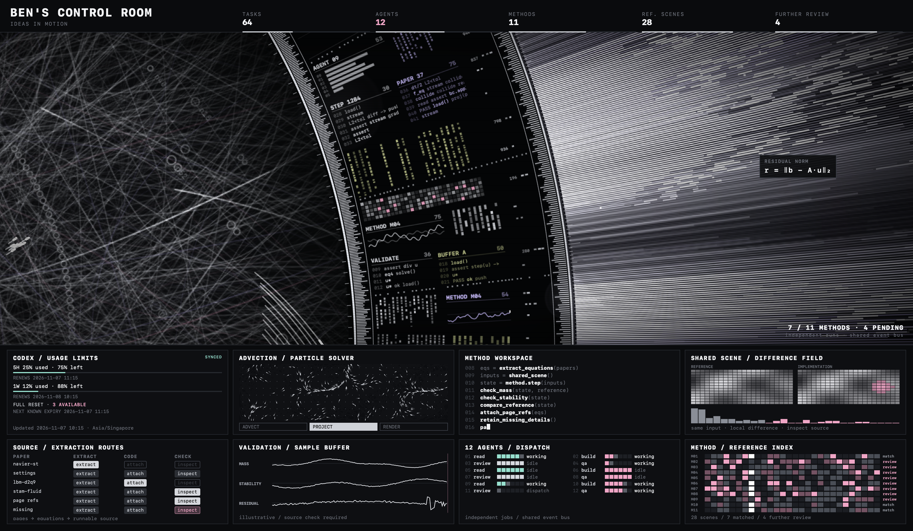

# HaloVeil

[English](README.md) · [简体中文](README.zh-CN.md) 

A silent, offline macOS screen saver with a rotating data ring, woven light field, and animated telemetry panels. Built on the startup and lifecycle fixes from the validated HALOFLUX macOS adaptation 1.5.0.



*Preview image uses sample Codex quota data.*

## Download and install

1. **[Download HaloVeil 1.1.0](https://raw.githubusercontent.com/BeeeeenY/haloveil/main/downloads/HaloVeil-1.1.0.zip)** and unzip it. The ZIP contains `HaloVeil.saver`; the GitHub “Source code” ZIP is the source project.
2. Double-click **`HaloVeil.saver`** and choose **Install for this user** when macOS asks.
3. Open **System Settings → Screen Saver**, scroll to **Other**, and select **HaloVeil**. On macOS versions that group these settings under Wallpaper, use **System Settings → Wallpaper → Screen Saver → Custom → Other → HaloVeil**.
4. Use **Preview** or a screen saver Hot Corner to start it. Move the pointer or press a key to exit; unlock normally if required.

After installing, you must select **HaloVeil under Other**; installing the file alone does not always switch the active screen saver. If it is missing, quit and reopen System Settings.

[Detailed installation / updates / removal](docs/INSTALL.md) · [中文安装说明](docs/INSTALL.zh-CN.md) · [SHA-256 checksums](downloads/SHA256SUMS)

The latest package is **1.1.0 / build 2**. [HaloVeil 1.0.0](https://raw.githubusercontent.com/BeeeeenY/haloveil/main/downloads/HaloVeil-1.0.0.zip) remains available as a historical download; `SHA256SUMS` lists the latest package only.

## What is included

- Native `ScreenSaverView` + `WKWebView`; bundled HTML/Canvas resources, with no server or network dependency.
- Silent playback. No audio files or Wallpaper Engine dependency.
- Startup preparation followed by a short fade-in, rather than exposing cold resource initialization.
- A 60 FPS animation target, batched particle drawing, and a bounded main-canvas pixel budget.
- One active renderer per display, with cross-process ownership and cleanup on exit, detachment, and sleep.
- Universal Apple Silicon + Intel binaries, a windowed preview app, build tools, and regression tests.
- The confirmed original preset **A**, with **45 runners** and all 56 scene parameters matched to [the reference configuration](tests/fixtures/original-config.json) across quality profiles.
- **BEN'S CONTROL ROOM** / **IDEAS IN MOTION** headings; the Codex panel occupies row 1, column 1, and the demo **12 AGENTS / DISPATCH** panel occupies row 2, column 3.

The 1.1.0 package includes an optional [Codex account usage panel and native file bridge](docs/CODEX-STATUS.md) with usage/remaining percentages, automatic renewal, available Full resets and the next known expiry, read from a fixed location outside the bundle. Collection requires separate opt-in setup; installing or previewing the screen saver does not start it. Other panels remain a visual demo. This screen saver does not replace the desktop wallpaper, password entry interface, startup screen, or FileVault unlock screen.

## Requirements

- The build targets macOS 12 or later; the adaptation was tested on **macOS Sonoma 14.4.1**. Other macOS releases and physical multi-monitor setups require their own verification.
- Downloaded builds are ad-hoc signed, **not Apple-notarized**. macOS may display a security prompt.
- Expect a brief dark preparation interval, approximately one second on the tested Mac, followed by a 0.18-second fade. Frame rate depends on the Mac and current workload.

## Preview the current source

Open `build/HaloVeil Preview.app` for the native windowed preview. After source changes, `./tools/build-preview.command` updates only that app without building an installable saver or release ZIP. The download also includes `HaloVeil Preview.app`.

For a separate browser preview, double-click `preview.command` or open [web/index.html](web/index.html) locally. No build, installation or background service is started. The Codex account file bridge requires the native preview; a browser shows `NO DATA` for that panel. Source changes are reviewed in Preview first and do not automatically replace the downloadable 1.1.0 release.

## Build an installable release (when requested)

Install Apple Command Line Tools (`xcode-select --install`) and Python 3, then run:

```sh
./build.command
python3 tools/package.py
```

These explicit release commands produce `build/HaloVeil.saver` and `build/HaloVeil Preview.app`, then refresh the versioned ZIP and checksum. They are not required for everyday browser preview. Update the release version and download links before publishing a new package.

```sh
./tests/run.command
./tests/startup.command
```

[Development guide](docs/DEVELOPMENT.md) · [Test coverage and limits](docs/TESTING.md) · [Publishing a release](docs/RELEASING.md) · [Changelog](CHANGELOG.md)

## License and credits

**Modified from [HALOFLUX by Ryder191 (RYDER CODE / Ms MAIKEBAIs CAT)](https://github.com/Ryder191/haloflux). Noncommercial use only.** The original visualization and visual design belong to the upstream author. HaloVeil is an independent macOS adaptation.

The original **[LICENSE](LICENSE)** is preserved, including the upstream notices and PolyForm Noncommercial 1.0.0 terms. Read it before using or redistributing the project. **Commercial use is prohibited. This project is not MIT-licensed.**

Original work: **HALOFLUX by Ryder191 (RYDER CODE / Ms MAIKEBAIs CAT)** — <https://github.com/Ryder191/haloflux>.

The macOS adaptation, packaging changes, and attribution are described in [NOTICE](NOTICE), [licensing notes](docs/LICENSING.md), and [source provenance](docs/UPSTREAM.md).
