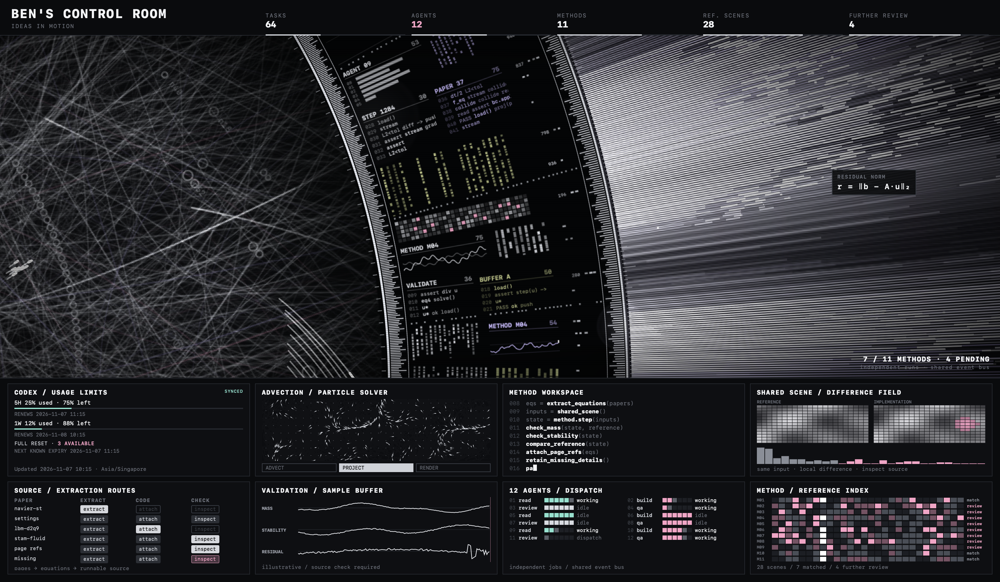

# HaloVeil · 光幕

[English](README.md) · [简体中文](README.zh-CN.md) 

一款无声、离线运行的 macOS 屏幕保护程序：旋转数据环、交织光场和动态遥测面板。基于已验收的 HALOFLUX macOS 适配版 1.5.0，保留启动预热与退出清理优化。



## 下载与安装

1. **[下载 HaloVeil 1.0.0](https://raw.githubusercontent.com/BeeeeenY/haloveil/main/downloads/HaloVeil-1.0.0.zip)** 并解压。安装包内含 `HaloVeil.saver`；GitHub 的「Source code」压缩包是源码项目。
2. 双击 **`HaloVeil.saver`**，在 macOS 提示时选择 **「仅为此用户安装」**。
3. 打开 **「系统设置 → 屏幕保护程序」**，向下滚动到 **「其他 / Other」**，点击 **HaloVeil** 切换。有些 macOS 版本的路径是 **「系统设置 → 墙纸 → 屏幕保护程序 → 自定 / Custom → 其他 / Other → HaloVeil」**。
4. 点击 **「预览 / Preview」**，或通过屏幕保护程序的触发角启动。移动鼠标或按键退出，需要密码时正常解锁。

**安装文件不一定会自动切换当前屏保，安装后请务必在「其他 / Other」中选中 HaloVeil。** 如果暂时看不到，退出并重新打开系统设置。

[完整安装、更新与卸载说明](docs/INSTALL.zh-CN.md) · [English installation guide](docs/INSTALL.md) · [SHA-256 校验值](downloads/SHA256SUMS)

## 功能

- 原生 `ScreenSaverView` + `WKWebView`，HTML/Canvas 资源随包提供，无需启动服务器或联网。
- 完全无声，不包含音频文件，不需要 Wallpaper Engine。
- 播放前先准备纹理与绘制路径，再短暂淡入，避免直接显示冷加载过程。
- 主动画目标 60 帧，粒子合并绘制，限制主画布像素预算。
- 每个屏幕只有一个活动渲染实例，跨进程独占；退出、移出窗口及休眠时释放资源。
- 提供 Apple Silicon 与 Intel 通用安装包、独立预览 App、构建工具和回归测试。

已发布的 1.0.0 安装包里的遥测数据属于 **视觉演示**。源码构建版新增可选的 [Codex 账户用量接入](docs/CODEX-STATUS.md)：显示已用/剩余额度、自动恢复时间、Full reset 可用次数及最近已知到期日期，通过包外固定目录读取；其他面板仍为视觉演示。屏保不替换桌面壁纸、密码输入界面、开机画面或 FileVault 解锁页。

## 运行要求

- 编译目标为 macOS 12 及以上；适配版已在 **macOS Sonoma 14.4.1** 测试。其他 macOS 版本和多物理显示器环境需要另行验证。
- 安装包使用本地签名，**未经过 Apple 公证**，系统可能出现安全提示。
- 启动会先有一小段深色准备画面，在测试机器上约 1 秒，随后约 0.18 秒淡入。实际帧率受硬件与系统负载影响。

## 预览当前源码

双击 `preview.command`，或用浏览器打开本机的 [web/index.html](web/index.html)，即可查看当前网页效果，无需构建、安装或启动后台服务。已有构建时，也可打开 `build/HaloVeil Preview.app` 进行原生窗口预览。Codex 状态文件读取需要原生预览；普通浏览器中该面板显示 `NO DATA`。

上方下载仍为稳定版 1.0.0 安装包。源码改动先通过预览确认，不会自动替换下载包。

## 构建可安装发布版（按需）

安装 Apple Command Line Tools（`xcode-select --install`）与 Python 3，然后运行：

```sh
./build.command
python3 tools/package.py
```

这些发布命令会生成 `build/HaloVeil.saver` 和 `build/HaloVeil Preview.app`，并更新对应版本的 ZIP 与校验值。日常浏览器预览无需运行它们。发布新安装包前，先更新版本号和下载链接。

```sh
./tests/run.command
./tests/startup.command
```

[开发说明](docs/DEVELOPMENT.md) · [测试范围与边界](docs/TESTING.md) · [GitHub 发布说明](docs/RELEASING.md) · [更新记录](CHANGELOG.md)

## 许可与致谢

**基于 [HALOFLUX by Ryder191（RYDER CODE / Ms MAIKEBAIs CAT）](https://github.com/Ryder191/haloflux) 修改，仅限非商业用途。** 原可视化及视觉设计属于原作者，HaloVeil 是独立的 macOS 适配项目。

本项目完整保留原作 **[LICENSE](LICENSE)**，包含作者声明、Required Notice 与 PolyForm Noncommercial 1.0.0 条款。使用或转发前请阅读完整许可。**禁止商业使用，本项目不是 MIT 许可。**

原作：**HALOFLUX by Ryder191（RYDER CODE / Ms MAIKEBAIs CAT）** — <https://github.com/Ryder191/haloflux>。

macOS 适配、打包修改与署名见 [NOTICE](NOTICE)、[许可说明](docs/LICENSING.md) 和 [来源记录](docs/UPSTREAM.md)。
